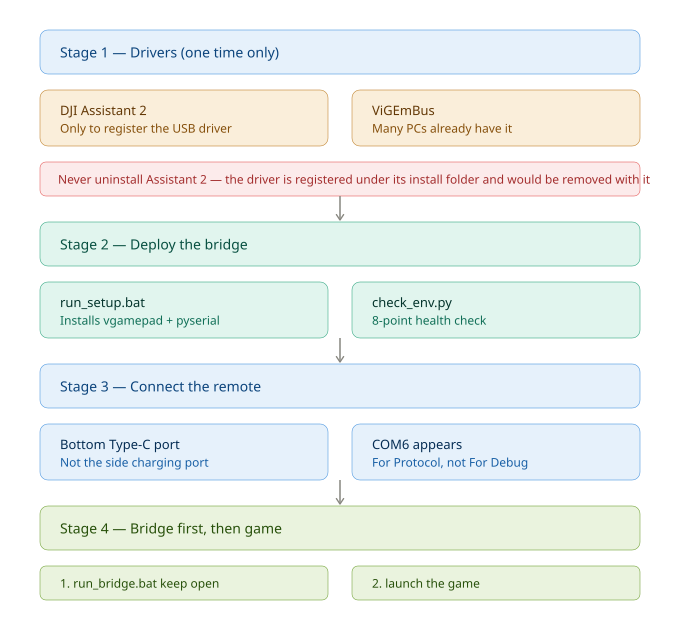

# DJI RC-N3 → Xbox 360 Gamepad Bridge

**用大疆 RC-N3 无人机遥控器当电脑游戏手柄，不需要买手柄。**
**Use a DJI RC-N3 drone remote as a PC gamepad. No gamepad purchase needed.**

一个 Windows 工具，把 RC-N3 通过 USB 伪装成 Xbox 360 手柄，插上就能玩飞行类游戏。
A Windows tool that makes the RC-N3 appear as an Xbox 360 controller over USB, so FPV
simulators and drone games accept it.

> 当前版本 / Current version: **v1.1.0** —— 云台波轮可触发左扳机 LT 开镜，按键映射可配置。
> This release adds wheel-to-LT ADS toggle and configurable button mapping.

---

## 目录 / Contents

- [一键部署（推荐）](#一键部署推荐--one-shot-setup-recommended)
- [怎么知道能不能用](#怎么知道能不能用--how-to-verify-it-works)
- [部署流程图](#部署流程图--deployment-flow)
- [手动部署](#手动部署--manual-setup)
- [致谢原项目](#致谢--acknowledgements)
- [低延迟版本改了什么](#低延迟版本改了什么--what-changed-in-the-low-latency-version)
- [蔚蓝无尽实测案例](#蔚蓝无尽实测案例--verified-case-azure-infinity)
- [按键映射实测结果](#按键映射实测结果--measured-button-map)
- [用波轮开镜](#用波轮开镜--wheel-to-lt-ads)
- [参数调校](#参数调校--tuning)
- [已知限制](#已知限制--known-limitations)
- [常见问题](#常见问题--faq)
- [更新日志](#更新日志--changelog)

---

## 一键部署（推荐）/ One-Shot Setup (Recommended)

> 三个文件，双击就行。/ Three files. Just double-click.
>
> 前提：已装 Python 3.9–3.12（安装时勾选 *Add Python to PATH*）
> Prerequisite: Python 3.9–3.12 installed with *Add Python to PATH* ticked

### 第 1 步 / Step 1 — 装驱动（只需一次）

**DJI Assistant 2** —— 只为注册 USB 串口驱动
<https://www.dji.com/downloads/softwares/dji-assistant-2-consumer-drones-series>

**ViGEmBus** —— 虚拟手柄总线驱动，很多电脑已经装了，先别急着下
<https://github.com/nefarius/ViGEmBus/releases>

> ⚠️ **装完 DJI Assistant 2 之后不要卸载它。**
> 驱动是注册在它的安装目录下的，卸载会把驱动一起注销掉，之后插遥控器又变成
> 「未知设备」，整条链路就断了。**装上之后不打开它**就行——因为它运行时会占住串口。
>
> ⚠️ **Never uninstall DJI Assistant 2.** The driver is registered inside its install
> folder; removing the software unregisters the driver too. Just leave it installed
> and never open it — while running, it holds the serial port hostage.

### 第 2 步 / Step 2 — 双击部署

```
run_setup.bat     Windows 一键部署
setup.sh          Linux / macOS / Git Bash
```

自动做三件事：装 `vgamepad` + `pyserial`、跑 8 项环境体检、告诉你还缺什么。

Installs the two Python libraries, runs an 8-point health check, and tells you
what is still missing.

### 第 3 步 / Step 3 — 接遥控器 / Connect the remote

1. 遥控器**开机** / Power on the remote
2. 插**底部**的 Type-C 数据口 —— 不是侧面的充电口
   Plug into the **bottom** Type-C port — not the side charging port
3. 设备管理器里应出现 `DEVICE USB VCOM For Protocol (COMx)`
   Device Manager should show `DEVICE USB VCOM For Protocol (COMx)`

> 随机附赠的是接手机用的转接线，**接电脑要另备一根 Type-A 对 Type-C 数据线**。
> The bundled cable is for phones. You need a USB-A to Type-C data cable.
>
> 遥控器会枚举出**两个**串口：`For Debug`（调试口，不可用）和 `For Protocol`（数据口，要用）。
> The remote enumerates **two** ports: `For Debug` (unused) and `For Protocol` (the one you want).

### 第 4 步 / Step 4 — 先桥接，再游戏 / Bridge first, then game

```
run_bridge.bat
```

**这个窗口必须一直开着**，关掉虚拟手柄就消失，游戏会变回无手柄状态。
**Keep this window open.** Closing it removes the virtual gamepad.

然后启动游戏，在控制设置里选 **Xbox 360**。
Then launch the game and choose **Xbox 360** as the controller.

窗口底部会实时显示状态，`延迟` 应该稳定在 **0.4–5 ms**：
The window shows live status. `延迟 / latency` should stay within **0.4–5 ms**:

```
延迟 2.5ms  包 223/s  循环 244543/s  积压 0B  油门[+####........]  横滚[----#-------]
```

---

## 怎么知道能不能用 / How to Verify It Works

> 💡 **先试这一招：重启遥控器。**
> 如果桥接看起来"没反应"——游戏里没手柄、按键没反应、状态行卡住不动、
> 或者干脆什么都识别不到——**把遥控器关机再开机，通常一次就解决**。
> **不用重启电脑，也不用重启游戏。**
>
> 💡 **Try power-cycling the remote first.**
> If the bridge seems unresponsive — no controller in the game, buttons not
> registering, the status line frozen, or nothing detected at all — **turn the
> remote off and on again. That usually fixes it in one go.**
> **No PC reboot needed, and no need to restart the game.**

> 🔄 **重新连接遥控器能解决大多数「小毛病」。**
> 本项目实测中遇到的一些现象——游戏突然认不到手柄、按键无响应、自检某一项
> 莫名失败、串口读不到数据——**遥控器重新开机后都能恢复**，不需要重装任何东西，
> 也不需要重启游戏。这是虚拟手柄设备的常见状态残留问题，不是本项目的缺陷。
>
> 🔄 **Reconnecting the remote clears most minor glitches.**
> Symptoms seen during testing — the game suddenly not seeing the controller,
> buttons not responding, a self-test check failing for no clear reason, the
> serial port returning no data — **all cleared after power-cycling the remote**,
> with no need to reinstall anything and no need to restart the game. This is
> ordinary state residue from a virtual controller, not a defect in this project.

**排查顺序 / Troubleshooting order**

按这个顺序试，从最轻的开始：

1. **重启遥控器** — 关机再开机。解决大部分问题
2. **重新插拔数据线** — 让串口重新枚举
3. **关掉 DJI Assistant 2** — 它可能又在后台占着串口
4. **跑自检** — `run_bridge.bat --selftest`，看清是哪一环挂了
5. **换根数据线** — 充电线不能传数据，这是最容易被忽略的一环

> ℹ️ 只有第 1 步会影响游戏状态。遥控器重新开机后，如果游戏里还是认不到手柄，
> **这时才需要重启游戏**（游戏只在启动时扫手柄）。前面的步骤都不需要。
>
> ℹ️ Only step 1 requires anything of the game. After power-cycling the remote,
> if the game still does not see the controller, **then restart the game** (it
> scans for controllers at launch). None of the other steps do.

**双击 bat 后窗口一闪就没了？** 加 `--selftest`，它会停下来告诉你原因，不会闪退。

**The bat window flashes and closes?** Add `--selftest` — it stops and tells you
why instead of vanishing.

在项目目录执行 / Run from the project folder:

```
run_bridge.bat --selftest
```

它做四件事，然后**停在 `pause` 等你看完**：

It does four checks, then **stops at `pause` so you can read the result**:

```
[自检] Python 版本 / Python version
[自检] 依赖库 / Dependencies
[自检] ViGEmBus 驱动 / driver
[自检] 串口 / Serial port
[自检] 桥接实测 8 秒 / bridge dry-run 8 s

==============================================================
  自检报告 / Self-test report
==============================================================

  运行时长 / Duration      8.0 s
  虚拟手柄 / Virtual pad   已创建 / created
  摇杆数据包 / Stick pkts   2016  (252/s)
  按键数据包 / Button pkts  1680  (210/s)
  总数据包 / Total pkts     3696  (462/s)
  缓冲区峰值 / Peak backlog 96 B

  [通过] 摇杆数据正常 / stick data flowing at 252/s
  [通过] 延迟正常 / latency nominal (2.3 ms)
```

### 结论怎么看 / How to read the verdict

| 输出 | 含义 | Meaning |
|---|---|---|
| `[通过] 摇杆数据正常` + 延迟 < 20ms | **环境可用** | Environment is ready |
| `[失败] 没有收到任何摇杆数据` | 遥控器没连好 | Remote not connected properly |
| `[失败] vgamepad 缺失` | 依赖没装 | Dependencies missing |
| `[失败] ViGEmBus 缺失` | 驱动没装 | Driver missing |
| `[警告] 延迟异常` 但有数据 | 能用但要查性能 | Works but check performance |

**关键指标**：看「摇杆数据包」那一行。**只要它在涨，链路就是通的。**
**The key line is "摇杆数据包 / Stick pkts". If it is climbing, the chain works.**

### 手动跑自检 / Running the self-test directly

```bash
python scripts/main_fast.py --rate 2 --selftest --selftest-seconds 10
```

退出码 `0` = 可用，`1` = 有问题。适合写进自动化检查。
Exit code `0` means ready, `1` means something is wrong. Suitable for scripting.

### 如果你用的是 PowerShell

用 `run_bridge.ps1`（语法正确的 PowerShell 版）：

```powershell
& ".\run_bridge.ps1"
```

自检：
```powershell
& ".\run_bridge.ps1" --selftest
```

如果提示禁止运行脚本，先执行一次：
If scripts are blocked, run this once first:

```powershell
Set-ExecutionPolicy -Scope Process -ExecutionPolicy Bypass
```

> ⚠️ **不要把 `.bat` 的内容一行行粘进 PowerShell。** 那是 cmd 语法，
> PowerShell 不认（`%变量%`、`%~dp0`、`if exist`、`goto` 全部无效）。
> **Never paste .bat contents into PowerShell.** That is cmd syntax — `%var%`,
> `%~dp0`, `if exist` and `goto` are all invalid there. Just double-click the
> `.bat`, or use `run_bridge.ps1`.
>
> 💡 两个 `.bat`（`run_setup.bat` / `run_bridge.bat`）**双击运行**即可，
> Windows 会自动用 cmd 打开。PowerShell 版 `.ps1` 可以右键「使用 PowerShell 运行」。
> Just double-click the `.bat` files — Windows opens cmd for them automatically.
>
> ⚠️ **bat 输出是英文，这是刻意为之。**
> `cmd.exe` 用 OEM 代码页（简体中文系统是 936）**逐行**解码 `.bat`，而 `chcp 65001`
> 要读到那一行才生效——**来不及**。所以中文写在 bat 里会变成乱码，进而让整行解析错位，
> 报出 `'xit' 不是内部或外部命令` 之类的怪异错误。**bat 里必须纯 ASCII，中文交给
> Python 输出。** 这是开发本项目时实际踩到的坑。
>
> ⚠️ **The .bat output is English on purpose.** `cmd.exe` decodes a `.bat` line by
> line using the OEM code page (936 on zh-CN), and `chcp 65001` only takes effect
> once it *reaches* that line — too late. Any Chinese in a `.bat` becomes mojibake,
> which desynchronises the parser and produces errors like
> `'xit' is not recognized as an internal or external command`. Keep `.bat` files
> pure ASCII and let Python print the Chinese. This is a real trap hit while
> building this project.

---

## 部署流程图 / Deployment Flow



完整版见 `assets/deploy-flow.svg`。要点：驱动装完**不要卸载**；桥接窗口**必须先于游戏**启动。
Full version in `assets/deploy-flow.svg`. Two things people get wrong: uninstalling
Assistant 2, and launching the game before the bridge.

---

## 手动部署 / Manual Setup

想自己敲命令的话，一共四步。

### 1. 装依赖 / Install dependencies

```bash
python -m pip install vgamepad pyserial
```

> ⚠️ **Python 必须是 3.9–3.12。** `vgamepad` 是老库，在 3.13+ 上装不上。
> **Python must be 3.9–3.12.** `vgamepad` predates 3.13 and will not build on it.

### 2. 体检 / Health check

```bash
python scripts/check_env.py
```

会检查 Python 版本、两个库、ViGEmBus 注册表、驱动文件、虚拟手柄创建、串口识别、
串口占用、以及 5 秒内能否读到数据包。报告会写进 `env-check-report.txt`。

Checks the Python version, both libraries, the ViGEmBus registry key, the driver
file, virtual gamepad creation, port detection, port contention, and whether data
actually flows within 5 seconds.

### 3. 启动桥接 / Start the bridge

```bash
python scripts/main_fast.py --rate 2
```

可选参数 / Optional flags:

| 参数 | 作用 | Meaning |
|---|---|---|
| `--rate 2` | 每 2 秒刷新状态行 | refresh the status line every 2 s |
| `--invert lv rh` | 反转指定轴 | invert the named axes |
| `--deadzone 300` | 消除中位漂移 | kill centre drift |
| `--scale 0.8` | 降低灵敏度 | lower sensitivity |
| `-p COM6` | 手动指定串口 | pin the serial port |
| `--wheel-up lt` | 波轮拨上：`lt` 开镜（默认）/ `dpad-up` 旧行为 / `off` 关闭 | wheel up: LT / D-pad up / off |
| `--wheel-down dpad-down` | 波轮拨下：`dpad-down` 切倍率（默认）/ `lt` / `off` | wheel down: D-pad down / LT / off |
| `--wheel-trigger toggle` | `toggle` 边缘脉冲 / `hold` 按住持续 | toggle pulse or hold |
| `--wheel-pulse-ms 90` | 脉冲持续毫秒，仅 toggle 生效 | pulse length in ms, toggle only |
| `--shutter-key a` | 拍摄键映射：`a` / `b` / `x` / `y` / `off` | shutter key mapping |
| `--aux-key rb` | Fn 键映射：`lb` / `rb` / `y` / `back` / `off` | Fn key mapping |

参数可以叠加传进 `run_bridge.bat`，例如
`run_bridge.bat --wheel-trigger hold --wheel-pulse-ms 200`。
Flags can be appended to `run_bridge.bat`, which forwards them via `%*`.

### 4. 启动游戏 / Launch the game

游戏里选 Xbox 360 手柄。第一次玩建议在训练场里先校准摇杆行程。
Choose the Xbox 360 controller. On first run, calibrate stick travel in the
training field.

---

## 致谢 / Acknowledgements

这个项目**站在两位前人的肩膀上**，没有他们就没有这个工具。

This project **stands on the shoulders of two earlier efforts**. Without them
there would be no tool.

### 1. IvanYaky — DJI_RC-N1_SIMULATOR_FLY_DCL

<https://github.com/IvanYaky/DJI_RC-N1_SIMULATOR_FLY_DCL>

**解决了最核心的问题：怎么跟大疆遥控器说话。**
Solved the hardest part: how to talk to a DJI remote.

大疆的遥控器通过 USB 枚举成一个串口，用一套叫 **DUML** 的私有协议传输摇杆数据。
没有这份代码，我不知道从哪读、也不知道该怎么解析包结构。
这个仓库最早针对 Mavic 3 的 RC-N1 写的，把 DUML 协议、CRC 校验、摇杆数值换算
全部摸清楚了。

The DJI remote enumerates as a serial port and streams stick data over a private
protocol called **DUML**. This repo reverse-engineered the protocol, its CRC
checksum, and the channel value scaling. That knowledge is the foundation here.

> 本项目的 `main_fast.py` 是**在它的协议实现基础上重写了 I/O 层**，
> 摇杆解析部分沿用其成果。
> This project's `main_fast.py` **rewrites the I/O layer** on top of its protocol
> work. The stick-parsing logic is built on theirs.

### 2. shr101 — dji-rc-n3

<https://github.com/shr101/dji-rc-n3>

**把协议从 RC-N1 移植到了 RC-N3。**
Ported the protocol work from RC-N1 to RC-N3.

RC-N1 和 RC-N3 的硬件 ID 和包长不同，原版代码读不出来。作者改了这部分，
让它能在 RC-N3 上工作。**本项目直接使用了它的按键位掩码**（`0x1060` / `0x1080` /
`0x1004` / `0x1002`），这几个值决定了哪个物理键对应哪个 Xbox 按键。

The two remotes differ in hardware ID and packet layout, so the original code
could not read them. This repo made it work on RC-N3, and **the button bitmasks
used here come directly from it**.

### 3. ViGEmBus / vgamepad 生态 / The ViGEmBus ecosystem

<https://github.com/nefarius/ViGEmBus> · <https://pypi.org/project/vgamepad/>

Windows 的 XInput 只认 Xbox 格式的手柄，ViGEmBus 提供了一条虚拟总线，
`vgamepad` 在上面挂载虚拟 Xbox 360 设备。**本项目完全是站在这两个组件之上的。**
Windows XInput only accepts Xbox-format controllers. ViGEmBus provides the virtual
bus and `vgamepad` attaches a virtual Xbox 360 device to it. This project sits
entirely on top of those two.

### 关于许可 / Licence note

本仓库发布时，**原项目的作者尚未就再分发作出明确声明**。若你要 fork 或再发布，
请先确认 `shr101/dji-rc-n3` 和 `IvanYaky/DJI_RC-N1_SIMULATOR_FLY_DCL` 的许可条款。
如果你就是原作者之一，请补充许可声明，我会同步更新。
At the time of publishing, **the original authors have not stated redistribution
terms**. Check both upstream licences before forking or redistributing. If you
are one of the authors, please add a licence and I will update this.

---

## 低延迟版本改了什么 / What Changed in the Low-Latency Version

原版在真实使用中**延迟接近 1 秒**，手柄基本没法用。本项目实测降到 **0.4–5 ms**，
提升约 300 倍。

The original had a **latency of nearly one second**, which made it unusable in
practice. Measured here: **0.4–5 ms**, roughly a 300× improvement.

### 问题的根源 / Root cause

原版 `main.py` 有三个问题叠在一起：

The original had three problems compounding:

| # | 问题 | Problem |
|---|---|---|
| 1 | 串口 `timeout=0.1`（100 ms），用 `s.read(1)` **逐字节阻塞式**找包头 | 100 ms serial timeout, byte-by-byte blocking reads hunting for a packet header |
| 2 | 主循环每轮**发 2 个请求却只读 1 个包**，响应在缓冲区堆积 → **读写错位** | sends 2 requests per round but reads only 1 packet — responses pile up and the stream **desynchronises** |
| 3 | 错位后反复扫 `0x55`，每次都可能**踩满 100 ms 超时** | once desynchronised it keeps scanning, and each scan can **burn the full 100 ms timeout** |

累积起来就是秒级延迟。`threaded_function` 里每轮还额外 `sleep(0.005)`，
跨线程传值又拖慢一层。
Together these compound into second-scale latency. A `sleep(0.005)` per round and
cross-thread value passing made it worse.

### 改法 / What I changed

| 项目 | 原版 | 本项目 | 效果 |
|---|---|---|---|
| 串口超时 | 100 ms | **1 ms** | 不再阻塞等待 |
| 读串口 | `s.read(1)` 逐字节 | **`s.in_waiting` + 批量读** | 零阻塞，一次读走全部 |
| 缓冲区 | 每次重开 | **滚动缓冲区全量解析** | 积压恒为 0 字节 |
| 线程模型 | 独立刷新线程 | **单线程收发解析刷新** | 消灭 GIL 竞争 |
| 请求频率 | 每轮 2 个 | **4 ms 一次（250 Hz）** | 采样率提高 |
| 按键处理 | 每轮全量 press/release | **边沿触发**，只在变化时动作 | 减少无效 API 调用 |
| 状态显示 | 无 | **实时延迟 / 包率 / 积压 / 轴值条** | 问题可观测 |

**实测结果 / Measured**（RTX 5060 Laptop, Windows 11）：

```
延迟 0.4ms  包 212/s  循环 244908/s  积压 0B
延迟 3.8ms  包 229/s  循环 244817/s  积压 0B
延迟 2.5ms  包 223/s  循环 244543/s  积压 0B
延迟 1.4ms  包 215/s  循环 244124/s  积压 0B
```

缓冲区积压**恒为 0**，数据实时流过而不排队。
Buffer backlog is **always zero** — data flows through without queueing.

### 附带产物 / Bonus tooling

- **`scripts/check_env.py`** —— 8 项体检，可重复运行。换电脑、重装系统后再验一遍
  不用手动敲命令排查。8-point health check, re-runnable after a machine change.
- **`scripts/identify_buttons.py`** —— 按键识别工具。上游文档没写明 `b1`–`b4`
  到底对应哪个物理键，这个工具实测出来。Button identification tool, because the
  upstream docs never state which physical key each bitmask belongs to.

---

## 蔚蓝无尽实测案例 / Verified Case: Azure Infinity

**《蔚蓝无尽》**（国产无人机竞速模拟器，<https://www.zexdrone.com>，深圳泽芯未来开发，
持国家新闻出版署版号）——2026 年 8 月起作为 2026 中国模拟无人机竞速系列赛线上赛平台。

*Azure Infinity* is a Chinese FPV racing simulator by Shenzhen Zexin Future, approved
by the National Press and Publication Administration. Since August 2026 it hosts the
online heats of the 2026 China Simulated Drone Racing Series.

### 实测配置 / Tested configuration

| 项目 | 数值 |
|---|---|
| 遥控器 | DJI RC-N3（硬件 ID `VID_2CA3&PID_1020`） |
| 遥控器固件 / Remote version | DJI Assistant 2 V2.1.42.0 |
| 串口 | `DEVICE USB VCOM For Protocol (COM6)` |
| ViGEmBus | 1.17.333.0 |
| Python | 3.12.1 |
| 电脑 / Machine | RTX 5060 Laptop, 16 GB, Windows 11 家庭中文版 |
| 延迟 / Latency | **0.4–4 ms** |

### 遇到的问题与解决 / Problems hit and how they were solved

**① 摇杆完全无反应 / Sticks dead**

游戏里键盘鼠标正常，但摇杆没反应。查进程发现**桥接脚本根本没在跑**。
虚拟手柄方案不是即插即用的——必须有 Python 进程持续运行、一遍遍把摇杆数据
写进虚拟手柄。命令行窗口一关，手柄就消失。

Keyboard worked, sticks did not. The bridge process was not running. This is not a
plug-and-play device: a Python process must stay alive, continuously writing stick
data into the virtual gamepad. Close the window and the gamepad is gone.

**② 脚本窗口闪退 / Script window flashing closed**

同一台机器上装了**两个 Python**。Bash 里的 `python` 指向另一个没装依赖的环境，
一运行就 `ModuleNotFoundError: No module named 'serial'`，窗口一闪即消。
`run_bridge.bat` 里因此**优先使用 Python 3.12 的绝对路径**——该文件不存在时才
回退到 PATH 里的 `python`。`run_bridge.ps1` 才会依次遍历 3.12/3.11/3.10/3.9。

Two Pythons on one machine. The one on PATH had no dependencies, so the script
died instantly. `run_bridge.bat` therefore **prefers the absolute Python 3.12 path**
and falls back to `python` on PATH only when that file is missing.
`run_bridge.ps1` is the one that probes 3.12/3.11/3.10/3.9 in turn.

**③ 延迟近 1 秒 / Latency near one second**

见上文低延迟章节。修完后稳定在 1–5 ms。
See the low-latency section above.

**④ 装 ViGEmBus 前的误判 / A wrong call about ViGEmBus**

最初只查了卸载注册表项，判断「未安装」，于是下载了安装包并计划重启电脑。
后来查驱动文件才发现**本机早就装好了 ViGEmBus 1.17.333.0**。
**根本不需要装，也不需要重启。** 教训：查驱动状态要查文件本体，不要只看注册表。
An early check that only looked at the uninstall registry said "not installed".
The driver file was already there — **no install and no reboot needed**. Lesson:
look at the driver file, not just the registry.

**⑤ 偶发的小毛病，重新连接遥控器就能解决 / Minor glitches, cleared by reconnecting the remote**

实际游玩过程中遇到过一些小状况——游戏突然认不到手柄、按键没反应、自检某一项
莫名失败、串口读不到数据。**这些把遥控器关机再开机后全部恢复，不需要重装任何
东西，也不需要重启游戏。**

Several symptoms showed up during actual play — the game suddenly not seeing the
controller, buttons not responding, a self-test check failing for no clear reason,
the serial port returning no data. **All of them cleared after turning the remote
off and on again — nothing to reinstall, and no need to restart the game.**

这类现象是虚拟手柄设备的状态残留，不是本项目的缺陷。遇到时**先重新连接遥控器**，
而不是急着排查代码。
These are state-residue effects of any virtual controller, not a defect in this
project. When you hit one, **power-cycle the remote** rather than debugging the code.

**⑥ 顺带一提 / Worth knowing**

如果启动时报串口被占用（`PermissionError` / `拒绝访问`），说明上一次的
`main_fast.py` 进程还活着。打开任务管理器结束残留的 `python.exe` 后重试。
`run_bridge.bat` 本身**不做进程清理**——它只负责找 Python 并启动脚本。

If startup fails with a serial-port error (`PermissionError` / access denied), a
previous `main_fast.py` is still alive. Kill the leftover `python.exe` in Task
Manager and retry. `run_bridge.bat` itself **does no process cleanup** — it only
locates Python and launches the script.

### 结论 / Verdict

**可以正常玩。** 摇杆响应实时，四轴映射正确，延迟对竞速完全够用。
**It works.** Stick response is real-time, all four axes map correctly, and the
latency is fine for racing.

---

## 按键映射实测结果 / Measured Button Map

上游文档没有写明 `b1`–`b4` 对应哪个物理键。用 `scripts/identify_buttons.py`
逐键实测，再以游戏内实际效果校正，结果如下 / The upstream docs never state which
physical key each bitmask belongs to. Measured with `scripts/identify_buttons.py`
and corrected against in-game behaviour:

| 位掩码 Mask | 变量 | 物理键 Physical key | 映射到 Mapped to | 游戏内效果 In-game |
|---|---|---|---|---|
| `0x1060` | b1 | **拍摄键** | Xbox **A** | 跳跃 Jump |
| `0x1080` | b2 | **返航键** | Xbox **RT**（右扳机） | 开火 Fire |
| `0x1004` | b3 | **模式切换键** | Xbox **X** | 换弹 Reload |
| `0x1002` | b4 | **Fn 键** | Xbox **RB** | 未绑定 Unbound |
| `0x1001` | — | **未登记**（上游代码未使用） | — | — |

> ⚠️ **首次识别时这张表填错了四行。** 2026-10-04 用识别工具逐个按物理键填表，
> 结果四组全部错位；10-07 在《三角洲行动》里实测才发现。**以游戏内实际效果为准。**
>
> ⚠️ **The first pass filled all four rows wrong.** The identification tool needs
> each key held individually; a mis-press shifted every entry. Corrected in-game on
> 10-07. **Trust observed behaviour, not the tool's key labels.**

原始数据见 `docs/button_map.txt`。
Raw data in `docs/button_map.txt`.

### 四轴映射 / Axis mapping

RC-N3 用 **Mode 2 美国手**布局，通道顺序 AETR：

| 通道 | 功能 | 位置 | 虚拟手柄 |
|---|---|---|---|
| CH1 | Roll 横滚 | 右摇杆左右 | 右摇杆 X |
| CH2 | Pitch 俯仰 | 右摇杆上下 | 右摇杆 Y |
| CH3 | Throttle 油门 | 左摇杆上下（弹簧回中） | 左摇杆 Y |
| CH4 | Yaw 偏航 | 左摇杆左右 | 左摇杆 X |

### 其他映射 / Other mappings

| 遥控器 | 虚拟手柄 | 说明 |
|---|---|---|
| 云台波轮拨**上** | **LT**（左扳机） | 开镜。默认 toggle 模式下发一次 90 ms 脉冲 |
| 云台波轮拨**下** | 十字键 **下** | 切换瞄具 / 倍率 |

波轮只映射上下，**没有左右**；它是开关量不是连续量。
The wheel maps up/down only — **no left/right**; it is a switch, not a continuous axis.

**未映射 / Not mapped:** LB、Y、B 三个 Xbox 键没有对应的 RC-N3 按键。
在游戏里可以自己把需要的动作绑到 A / X / RB / RT 上。
LB, Y and B are unused. Bind whatever you like to A / X / RB / RT in-game.

---

## 用波轮开镜 / Wheel-to-LT ADS

云台波轮拨上会发**左扳机 LT**，对应游戏里的「瞄准」。两种模式要和游戏里的开镜设置配对：

| `--wheel-trigger` | 游戏里「瞄准」设成 | 行为 |
|---|---|---|
| `toggle`（默认） | **切换**开镜 | 拨上发一次 90 ms LT 脉冲，游戏自己保持开镜；再拨一次关镜 |
| `hold` | **按住**开镜 | 拨上时持续按住 LT，波轮回中就松开 |

**前提：游戏里必须把「瞄准」绑定到 LT。** 如果那一行是空的，代码发再多 LT 也收不到——
这是「波轮拨上没反应」最常见的原因。Delta Force 里检查「设置 → 控制 → 瞄准」。

**Precondition: bind "Aim" to LT in the game.** If that binding is empty, the
bridge can send LT forever and nothing happens. This is the most common cause of
"wheel up does nothing".

### 调参 / Tuning

| 现象 | 处理 |
|---|---|
| 脉冲太短，游戏没识别到 | `--wheel-pulse-ms 200` |
| 游戏里是「按住开镜」 | `--wheel-trigger hold` |
| 想回到旧行为（十字键上） | `--wheel-up dpad-up` |
| 不想要开镜 | `--wheel-up off` |

### 一个物理限制 / A physical constraint

波轮是**弹簧回中**的。开镜后想切倍率，必须**先松手让波轮回中**，再向下拨——
否则从「上」直接掰到「下」会跨过中位，触发逻辑看到的是同一次动作。
这不是软件缺陷，是回中结构决定的。

The wheel springs back to centre. After aiming, **release it so it returns to
centre**, then push down. Going straight from up to down crosses the centre
without ever reporting a neutral state.

---

## 参数调校 / Tuning

真实遥控器的核心手感来自 **Rates 增距**和 **Expo 指数曲线**，虚拟手柄拿不到这两个
（原因见下节）。可以用下面两个参数近似补偿：

The feel of a real transmitter comes from **rates** and **expo**, which a virtual
gamepad cannot carry (see limitations). These two parameters approximate them:

| 想要 | 用什么 | 例子 |
|---|---|---|
| 觉得太灵敏，推杆猛 | `--scale` 缩小幅度 | `--scale 0.75` |
| 摇杆中位漂移，飞机自己飘 | `--deadzone` 加死区 | `--deadzone 300` |
| 某个方向反了 | `--invert` 反转该轴 | `--invert lv` |
| 想要更跟手 | `--scale` 放大 | `--scale 1.2` |

组合使用 / Combine them:

```bash
python scripts/main_fast.py --rate 2 --scale 0.8 --deadzone 300
```

---

## 已知限制 / Known Limitations

**① 拿不到 Rates 和 Expo / No rates, no expo**

这是最实质的限制。真实遥控器上，**Rates** 决定推满时飞机转多快（°/秒），
**Expo** 让中位柔和、拉满给满舵量。虚拟手柄只有线性输出。

This is the real one. **Rates** sets how fast the aircraft rotates at full stick,
and **expo** softens the centre while giving full throw at the limit. A virtual
gamepad is linear through and through. Expect noticeably different cornering
feel from a real transmitter.

**② 油门是弹簧回中杆，不是扳机 / Throttle is a spring-loaded stick, not a trigger**

需要模拟扳机（RT/LT 连续量）的游戏——赛车、射击——玩不了。RT 只有 0 和 255
两态，推油门是一顿一顿的。
Games needing analogue triggers (racing, shooters) will not work.

**③ 不是所有游戏都认虚拟手柄 / Not every game accepts it**

游戏必须在启动时扫到手柄。桥接窗口开着但游戏先启动的话，游戏不知道有手柄。
The game scans for controllers at launch. If the game started before the bridge,
it never sees one.

**④ 上游未提供许可声明 / Upstream licence unstated**

见「致谢」一节。见 acknowledgements above.

---

## 常见问题 / FAQ

**Q: 桥接没反应 / 游戏里没手柄 / 按键不灵 / 状态行卡住不动？**
**A: 先重启遥控器（关机再开机）。** 这是虚拟手柄最常见的状态残留问题，
重新连接通常一次解决。本项目实测中遇到的这些小毛病，遥控器重新开机后都能恢复，
不需要重装任何东西，**也不用重启电脑、不用重启游戏**。
不行再按这个顺序排查：重插数据线让串口重新枚举 → 关掉 DJI Assistant 2 →
跑 `run_bridge.bat --selftest` → 换一根数据线（充电线不能传数据）。

**Q: The bridge is unresponsive / game sees no controller / buttons dead /
status line frozen?**
**A: Power-cycle the remote first (turn it off, then on).** This is the most
common state-residue problem with virtual controllers, and reconnecting the remote
cleared every instance seen while building this. No reinstall needed, **no PC
reboot needed, and no need to restart the game**. If that does not help, work
through: replug the cable so the port re-enumerates → close DJI Assistant 2 →
run `run_bridge.bat --selftest` → try a different cable (charge-only cables carry
no data).

**Q: 装完 Assistant 2 是不是就可以卸载了？**
**A: 不能。** 驱动注册在它的安装目录下，卸载会一并注销，之后插遥控器又变成
「未知设备」。装上不打开即可。

**Q: Can I uninstall Assistant 2 now that the driver is registered?**
**A: No.** The driver is registered inside its install folder and is unregistered
along with the software. Leave it installed and never open it.

**Q: 脚本窗口闪退怎么办？**
**A: 九成是 Python 版本不对。** 用 `run_setup.bat`，它会硬编码绝对路径。
若仍闪退，手动跑 `python scripts/check_env.py` 看哪一项挂了。

**Q: The script window flashes and closes.**
**A: Usually the wrong Python.** Use `run_setup.bat`, which hardcodes the path. If
it still dies, run `python scripts/check_env.py` to see which check fails.

**Q: 双击 run_bridge.bat 没有任何反应？**
**A: 加 `--selftest` 看诊断。** `run_bridge.bat --selftest` 会停下来告诉你哪一环挂了。
如果连自检窗口都不出现，先确认 DJI Assistant 2 已经在后台运行并占着 COM6：
```bash
taskkill /F /IM python.exe
```

**Q: The bat window flashes and closes.**
**A: Run `run_bridge.bat --selftest` for a diagnosis.** It stops and reports which
stage failed instead of vanishing. If even the self-test window does not appear,
DJI Assistant 2 may be holding the port — kill stale processes with
`taskkill /F /IM python.exe`.

**Q: 我用的是 PowerShell，能直接双击 bat 吗？**
**A: 能，但别把 bat 内容粘进 PowerShell。** 那是 cmd 语法，`%变量%`、`%~dp0`、
`if exist`、`goto` 在 PowerShell 里全部无效。想用 PowerShell 就跑 `run_bridge.ps1`：
```powershell
& ".\run_bridge.ps1"
```

**Q: I use PowerShell. Can I still double-click the bat?**
**A: Yes, but never paste the bat contents into PowerShell.** That is cmd syntax.
Use `run_bridge.ps1` for a PowerShell-native version.

**Q: 会不会和别的 Python 打架？**
**A: 会，所以启动器优先用固定路径。** 本项目在开发时就踩过这个坑：同一台机器
装了两个 Python，Bash 里的那个没装依赖，脚本一运行就 `ModuleNotFoundError`，
窗口一闪即消。`run_bridge.bat` 固定使用 Python 3.12 的安装路径，该文件不存在时
才回退到 PATH 里的 `python`；`run_bridge.ps1` 才会依次尝试 3.12/3.11/3.10/3.9。

**Q: Will it conflict with another Python?**
**A: It can, so the launcher prefers a fixed path.** This was a real bug during
development: two Pythons on one machine, the one on PATH had no dependencies, and
the script died with `ModuleNotFoundError` the instant it started. `run_bridge.bat`
uses the Python 3.12 install path and falls back to `python` on PATH only if that
file is missing; `run_bridge.ps1` is the one that probes 3.12/3.11/3.10/3.9.

**Q: 游戏里选 Xbox 360 没用？**
**A: 顺序反了。** 游戏只在启动时扫手柄。先开桥接窗口，再启动游戏。

**Q: The game does not pick up the controller.**
**A: Wrong order.** The game scans at launch. Start the bridge first, then the game.

**Q: 需要买手柄吗？**
**A: 不需要。** 除了下面说的硬件升级，这套方案零成本。

**Q: Do I need to buy a gamepad?**
**A: No.** The whole approach is free, apart from the hardware upgrade below.

**Q: 想长期玩竞速怎么办？**
**A: 换真设备。** 攒钱上 **ELRS 接收机 + Betaflight 飞控**，或直接买支持
EdgeTX 的开源遥控器（如 Radiomaster Boxer、Zorro）。那才是游戏说的「遥控器通道」，
rates 和 expo 全部生效。RC-N3 + 虚拟手柄适合入门练手，天赋上限就在这。

**Q: I want to play long-term.**
**A: Get real hardware.** An ELRS receiver plus a Betaflight FC, or an EdgeTX
transmitter such as a Radiomaster Boxer or Zorro. That is the "transmitter channel"
the game means, where rates and expo actually apply. RC-N3 plus a virtual gamepad
is a good trainer with a low ceiling.

---

## 更新日志 / Changelog

### v1.1.0 — 2026-10-17

**新增**

- 云台波轮拨上映射**左扳机 LT**，用来开镜。支持 `toggle`（边缘脉冲，配游戏「切换开镜」）
  和 `hold`（按住，配游戏「按住开镜」）两种模式。
- `--wheel-up` / `--wheel-down` / `--wheel-trigger` / `--wheel-pulse-ms` 四个波轮参数。
- `--shutter-key` / `--aux-key`，拍摄键与 Fn 键的映射可以改。
- 启动时打印配置摘要，参数是否生效一眼可见。

**修复**

- `run_bridge.bat` 从 217 行简化为 6 行，用 `%*` 透传参数。原版硬编码 `--rate 2`，
  新增的波轮参数根本传不进去。
- `run_bridge.bat` 的 Python 路径回退逻辑是死代码（`if not defined PY` 恒为假），
  改为 `if not exist`。没装 Python 3.12 的机器现在能回退到 PATH。

**文档**

- 按键映射表整表重写。原表是 2026-10-04 首次识别的错误结果，四组物理键全部错位，
  已按 10-07 游戏内实测更正。
- 补充 6 个新参数说明，「参数调校」前新增「用波轮开镜」一节。
- 删掉「bat 会清理残留进程」的过时描述。

### v1.0.0 — 2026-10-06

- 低延迟重写：延迟从约 1 秒降到 **0.4–5 ms**。
- 附带 `check_env.py`（8 项环境体检）与 `identify_buttons.py`（按键识别）。

---

## 许可 / Licence

见「致谢」一节的许可说明。
See the licence note under acknowledgements.

## 致谢 / Credits

- [IvanYaky/DJI_RC-N1_SIMULATOR_FLY_DCL](https://github.com/IvanYaky/DJI_RC-N1_SIMULATOR_FLY_DCL) — DUML 协议
- [shr101/dji-rc-n3](https://github.com/shr101/dji-rc-n3) — RC-N3 协议移植
- [nefarius/ViGEmBus](https://github.com/nefarius/ViGEmBus) — 虚拟手柄总线
- [vgamepad](https://pypi.org/project/vgamepad/) — Python 绑定
